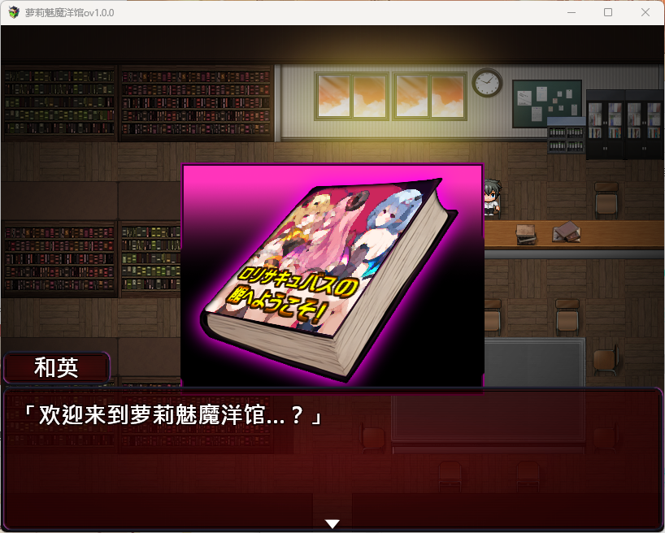
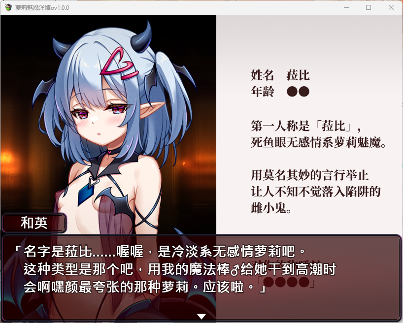
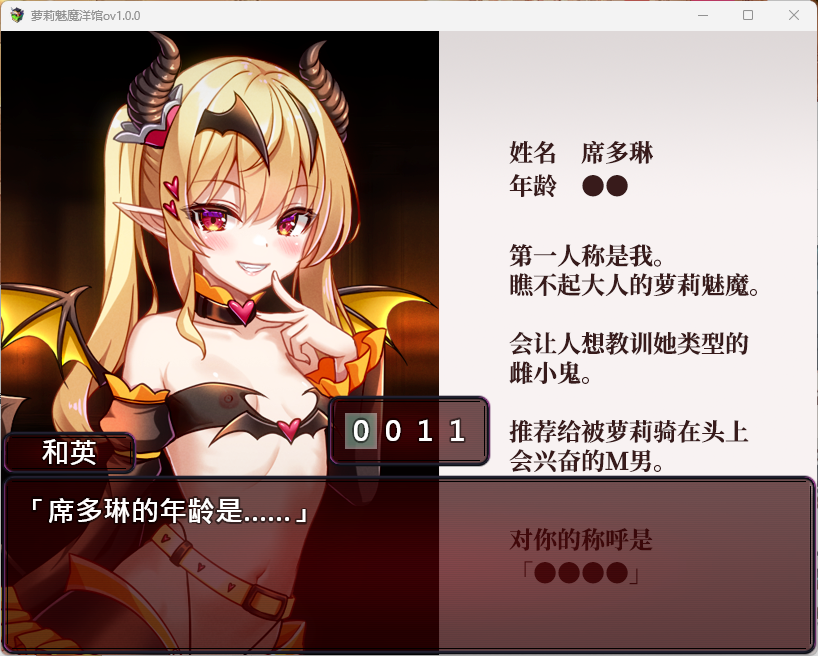
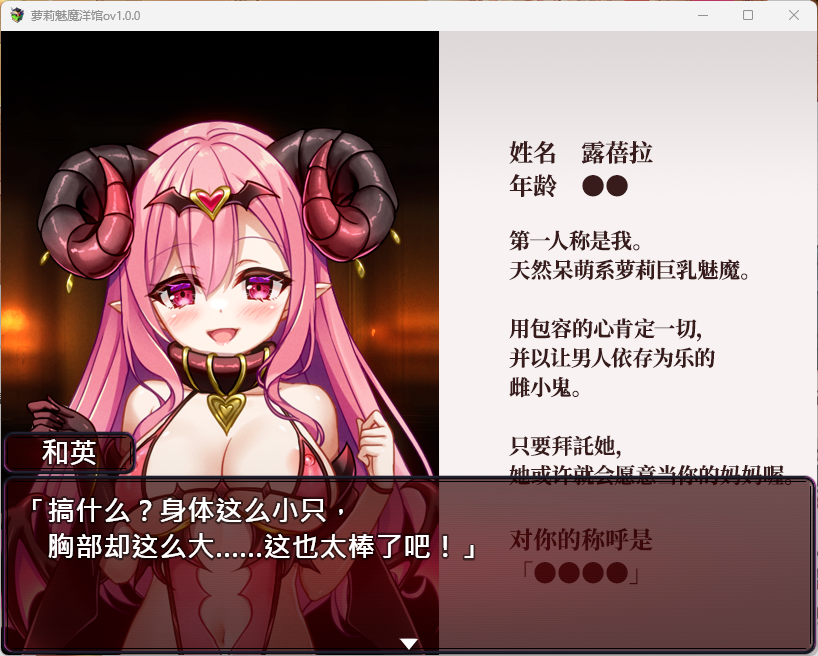
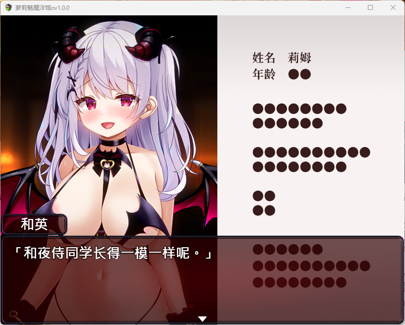
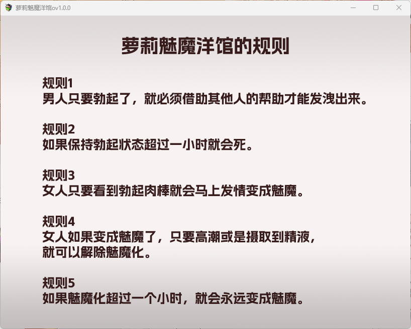

43.ロリサキュバスの館
---
久违的更新一下，上次更新是什么时候，居然是三个月前

这次测评的黄油是萝莉魅魔洋馆

因为在网上看到某个梗图，图上内容说本作不能和萝莉魅魔游玩，出于好奇我便靠着强大的搜索引擎搜索到这款游戏，实际游玩下来发现，这不是全是和萝莉在玩嘛。（但是游戏内并没有出现和梗图一样的内容，所以我猜测应该是同会社的另一个游戏，但是我懒得找了）

游戏剧情比较白开水，男主是学校的图书管理员，在图书馆的工作结束准备回家时撞到了准备还书的女主，男主拿到书准备登记还书时却看到书名是

<small style="color:gray; display:block; text-align:center;">欢迎来到萝莉魅魔洋馆</small>

随后男主翻看发现就是一本小黄书，里面三位萝莉魅魔分别叫拉比、席多琳、露蓓拉以及女主的魅魔形态莉姆

<small style="color:gray; display:block; text-align:center;">拉比</small>

<small style="color:gray; display:block; text-align:center;">席多琳</small>

<small style="color:gray; display:block; text-align:center;">露蓓拉</small>

<small style="color:gray; display:block; text-align:center;">莉姆</small>

随后男主发现了书本的规则，并且要签订同意书

<small style="color:gray; display:block; text-align:center;">规则</small>

在男主签订契约的同一时刻，女主冲了进来，说还错书了，在和女主对话后发现，女主看这本书时标题是成为色色魅魔的方式，而男主看这本书的标题则是萝莉魅魔洋馆，这时契约签订完成，书本发光男女主被吸到了书中世界。故事就此开始

游戏目标是离开魅魔洋馆，通过一些简单的小解密，以及各种色色的机关可以解锁cg，并且三个萝莉魅魔都有自己的房间，进入房间可以和萝莉魅魔互动。而游戏内有两个数值，一个是萝莉控度，另一个是女主的色色程度，分别拉满两个数值可以解锁两个结局，第一个结局是和三个萝莉魅魔在一起，另一个结局是成功逃出书中世界并与女主达成羁绊。

本作CG画的还算可以，主要是我喜欢萝莉，也喜欢魅魔，女主也很可爱，作为一款以解密为主的小黄油还算合格。

---
推荐度6/10
---
实用度5/10
---
可玩性5/10
---