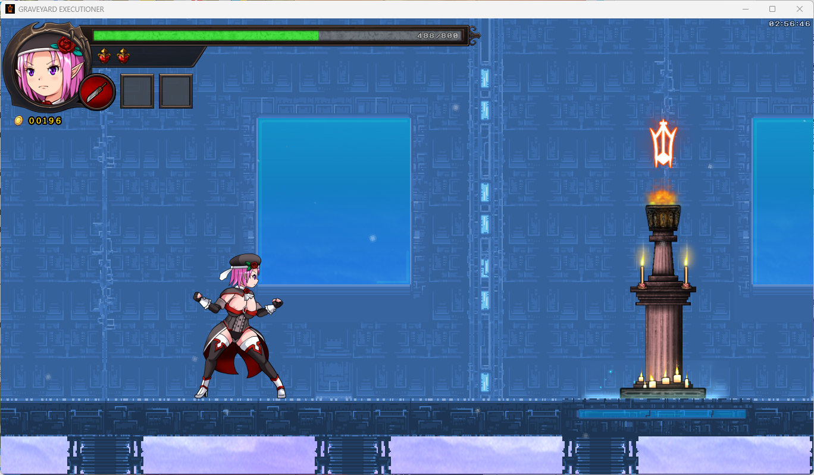

44.Graveyard Executioner
---
这次测评的黄油是Graveyard Executioner墓地行刑者

青色二极管会社出品，必属血腥猎奇作品，ACT类作品，横版闯关，手感蛮一般的，操作起来有粘滞感，打击感不足，不过都玩血腥猎奇类黄油了还要求这么多有点SB了。

游戏使用的是机器翻译，因此剧情我没怎么看明白，但大致来说的话就是两方王国黑王国和白王国产生战斗，白王国碾压胜利并且掳走了五个公主，而我们的女主角是黑王国王的亲臣，战败后十分懊悔，为了寻找并保护公主于是出发去讨伐白王国军队。不过比较难绷的是结局似乎是有外星生物在帮助白王国一方，最后要打的是一个异形外星生物...

实话实说其实玩下来没怎么感觉血腥，可能因为我下载源有点问题，玩的时候有很多贴图BUG，很多贴图都没显示出来，导致玩的时候没有啥感觉，不明不白的就打完了，并且由于一开始没打开垂直同步，在主角掉下悬崖回到出生点后整个贴图会直接消失不见，切板后才会重新加载出来，真难绷，我也不知道我在掉下悬崖后是怎么顶着个透明身躯绕过这么多小怪到达下一板的。

光论玩法的话这个游戏还算中规中矩，有合理的货币升级成长系统，武器数值给的都很慷慨，五把可以玩的武器，比较多样化，除了操作比较粘意外没啥缺点，CG的话没怎么看，本人不爱异种奸，还有一些是丸吞的，玩猎奇多半都是出于好奇，根本就不会有人拿来用吧。而且画风也很一般的说。总的来说不推荐吧，玩一玩还算可以，仅作记录。

<small style="color:gray; display:block; text-align:center;">游戏画面</small>

---
推荐度0/10
---
实用度0/10
---
可玩性6/10
---