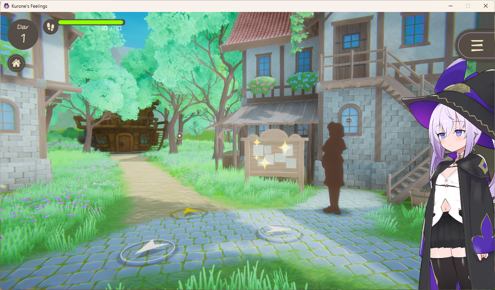

52.クロネのきもち～星降る村の魔女見習い～
---
ADV类黄油

剧情忘完了，但是现在的AI太好用了吧...

故事发生在一个人们信仰群星、存在魔法的世界。拥有魔力的人被称为“魔女”，能用魔法帮助他人改善生活。

主角是一位名叫 伊梅尔塔 的家里蹲魔女。某天，她为了寻找魔法素材进入森林，意外发现了一位拥有特殊魔力却失去记忆的少女——可洛妮。为了照料可洛妮，同时也为了研究她身上的特殊魔法，伊梅尔塔将她带回村庄，并让她成为了自己的“眷属”与助手。伊梅尔塔还给了可洛妮一块吊坠，用来吸收人们情绪变化时产生的魔力，以便进行研究。

哎哟我不用自己回想剧情就是舒服，故事结尾是魔女成功窥见世界真理，见到了附身在可洛妮身上的神，并且知道了可洛妮的真实身份其实是神的分身，帮助神观察世界的眼。

CG还可以，因为主角是无口萝莉哦哦哦哦哦哦哦哦，而我是萝莉控。嗯对。但是基本都是和野男人交配这个让我有点不爽，所以没什么印象了，我到底看没看CG..？

游戏玩法基本上就是探索村子，与村人对话，完成委托，获得魔力以及各种属性，在一定魔力阶段后就可以推进剧情，数值游戏。

算是做的比较精致的一个小游戏吧，地图还有建模啥的，看着都很舒服，BGM也做的不赖。

<small style="color:gray; display:block; text-align:center;">游戏画面</small>

---
推荐度6/10
---
实用度4/10
---
可玩性6.5/10
---